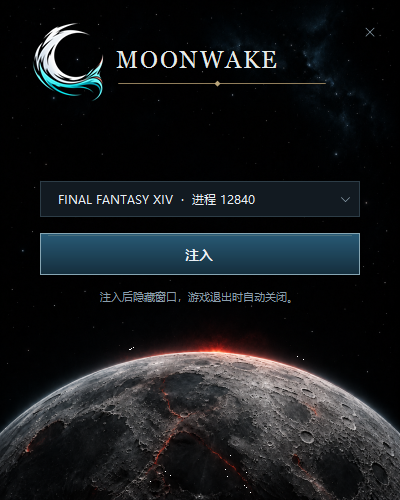

<div align="center">


# Moonwake

**A quiet companion for your next adventure.**

国服 Dalamud 注入工具

</div>

Moonwake 附加到已经启动的 FFXIV 客户端，为它加载 Dalamud 核心。无需通过登录器启动游戏；不处理账号、密码、登录或游戏更新。

**当前适配国服客户端 `2026.10.06.0000.0000`。项目尚未提供公开二进制发行版。**

## 使用方式

正常启动游戏，打开 Moonwake，选择目标游戏，再点击注入。成功后窗口隐藏，不驻留系统托盘；目标游戏实例退出后 Moonwake 自动结束。手动关闭 Moonwake 不会结束游戏。



免安装包的工具目录只包含程序和许可说明。Moonwake 使用当前 Windows 用户的 `%APPDATA%/XIVLauncherCN` 作为统一数据根目录：已有目录直接沿用；首次使用时自动创建，并准备包内附带的 Moonwake 核心、字体和运行时。程序不会创建 `%APPDATA%/Moonwake`。

插件文件与插件自身配置直接共用国服的 `installedPlugins` 和 `pluginConfigs`，无需搬迁。Moonwake 的核心设置、窗口布局和配置备份独立保存在 `XIVLauncherCN/moonwake`，国服的 `dalamudConfig.json` 只作为首次初始化和手动同步的数据来源。Moonwake 仍运行自己编译的核心，运行资源放在 XIVLauncherCN 内的版本目录，不替换国服启动器的核心。两个核心不能同时注入同一个游戏进程。

EXE 启动时会请求管理员权限，以便读取同样以管理员身份运行的游戏进程。点击“注入”后正常加载已启用的插件；未适配的后续游戏版本会提示更新 Moonwake。

首次使用自动沿用国服登记的开发插件路径、插件启用状态和配置组，之后由 Moonwake 独立保存加载偏好。开发插件直接加载原 DLL，重新编译后可以自动重载。插件安装、更新、卸载及插件自身设置仍写入共用目录，切换工具后继续使用。

游戏内界面默认使用 Moonwake Blue 和简体中文。主题、字体、窗口布局、通知等核心设置由 Moonwake 独立管理；可在游戏内设置中调整。

**Moonwake 不内置官方插件仓库。** 首次使用读取国服已有自定义仓库，之后独立保存。在“Moonwake 设置”→“测试版与高级设置”→“自定义插件仓库”中，可添加地址，或点击“同步国服自定义仓库”：默认只合并新地址，保留已有仓库及其启用状态，不修改国服列表。插件问题请联系对应插件或仓库的维护者。

## 从源码构建

需要 Windows x64、.NET 10 SDK、Git。核心还需要 Visual Studio 2022 C++ Build Tools / MSVC v143、Windows SDK 和 CMake 4.0 以上。

```powershell
./scripts/build-shell.ps1
./scripts/prepare-core.ps1
./scripts/build-core.ps1 -CMakePath cmake
```

桌面壳输出到 `artifacts/shell/`。核心源代码在 `.build/` 中从锁定的国际服提交物化并应用补丁；不会使用已安装的国服核心二进制。

上述命令生成用于开发的桌面壳。完整免安装包通过 `scripts/build-distribution.ps1` 嵌入经过校验的核心、Assets、.NET 和原生运行库，首次启动自动准备这些资源；包内不包含个人插件、仓库或配置。目前没有自动更新功能。构建与打包方法见 [BUILDING.md](BUILDING.md)。

## 来源与许可

Moonwake 桌面壳由 Astra 编写，采用 AI 开发，不喜勿用。桌面壳使用 MIT 许可。Dalamud 补丁按 AGPL-3.0-or-later 提供，FFXIVClientStructs 补丁按 MIT 提供；上游及参考实现的版权声明保留在 `licenses/` 和 `NOTICE.md`。

Moonwake 是独立项目，与 Square Enix、goatcorp 或 OtterCorp 无隶属关系。
